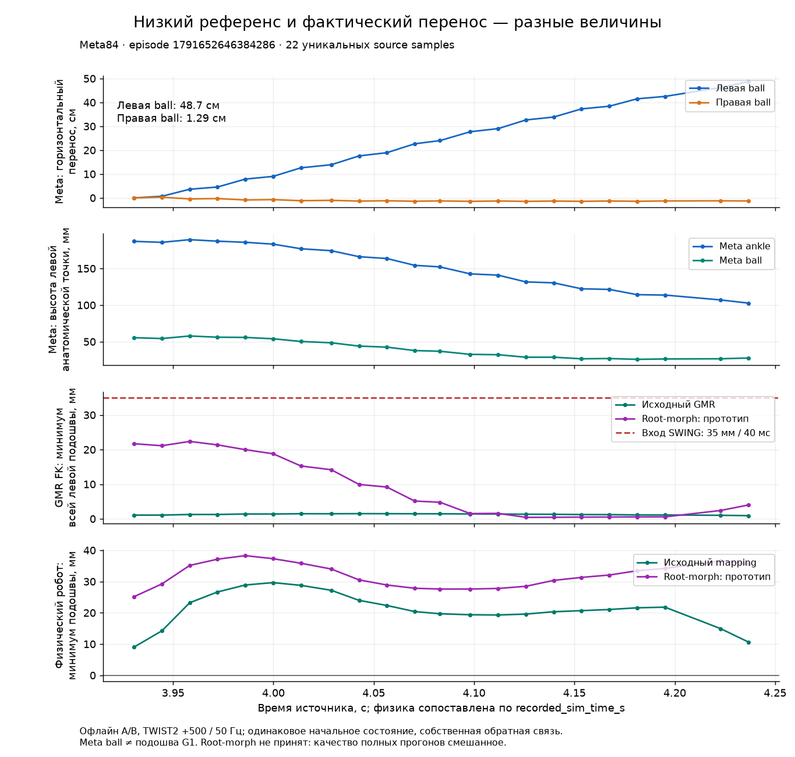

# Низкие переносы: разметка, ретаргетинг и физика

**0.424% — покрытие детектора SWING, а не частота шагов Meta.** На реальном
фрагменте нога переносится примерно на 40 см, хотя GMR-референс оставляет
подошву примерно в 1 мм от пола. Физическая политика на этом фрагменте уже
поднимает стопу выше. Ошибка референса сама по себе не доказывает запинание.

Статус на 12 октября 2026: обучение v1 **WITHDRAWN**, все четыре запуска
остановлены при actor updates = 0. Вариант разделения смещений `root-morph`
**NOT_PROMOTED**: парная физическая оценка дала смешанный результат.
Текущий mapping по умолчанию этим исследованием **не исправлен**.
Для v2 подготовлен фазонезависимый штраф низкого просвета, взвешенный
фактической скоростью; [очередь и её статус](clearance-v2/queue/README.md)
описаны отдельно. Результатов качества v2 здесь нет.
Контекст и архив v1 находятся в [README](README.md).

## Что измеряли 0.424%

Детектор использует нижнюю точку всей физической подошвы: минимум нижних
точек четырёх сфер контакта. Для входа в SWING требуются высота ≥35 мм
и подтверждение 40 мс; удержание допускает ≥25 мм. Скорость, вертикальная
скорость и вращение ограничивают **STANCE**, а не SWING. UNKNOWN означает,
что история не удовлетворяет этим правилам; нога при этом может двигаться.

| Quest train, 33 оригинала + 33 зеркала | Отсчёты двух стоп | STANCE | SWING | UNKNOWN | SWING, % |
| --- | ---: | ---: | ---: | ---: | ---: |
| Четыре окна по 1 с на клип | 26 400 | 4 098 | 112 | 22 190 | 0.424 |
| Полные клипы | 142 668 | 28 244 | 510 | 113 914 | 0.357 |

Окна начинаются на 10/35/60/85% от `(длительность − 1 с)`, содержат по
50 кадров при 50 Гц, история детектора сбрасывается перед каждым окном.
Один кадр даёт два отсчёта стоп. Все 66 исходных оконных счётчиков совпали
с опубликованным preflight при точной интерполяции pinned TWIST2.
Зеркальные клипы не являются независимыми демонстрациями.

В окнах только 98 отсчётов достигают 35 мм всей подошвой: 22 не проходят
временное подтверждение, 76 получают SWING; ещё 36 добавляет удержание
состояния. Получается 112. При этом хотя бы одна точка подошвы выше 35 мм
в 32.92% отсчётов. Наклонённая стопа с поднятой пяткой ещё не означает
просвет всей подошвы. Пропуск низких переносов в v1 обусловлен прежде всего
геометрическим условием, а не отсутствием движения или невалидным трекингом.

Дополнительный фазовый reward v1 исключал именно низкие переносы, ради
которых был предложен эксперимент. Общий штраф скольжения оставался активен,
но это не исправляло постановку. Простое снижение порога не является
проверенным распознавателем намерения переставить ногу.

## Конкретный пропущенный перенос

Запись `episode-1791652646384286`, последовательности 26103–26125:
22 уникальных кадра, 3.930563–4.236694 с источника, 6.68–6.98 с симуляции.
За 306 мс левая ankle перемещается горизонтально на 42.15 см, ball — на
48.68 см, противоположная ball — лишь на 1.29 см. Перемещение левой ball
относительно таза — 37.73 см; центр GMR-подошвы перемещается на 39.09 см.
Это отдельная перестановка генеративной ноги, которую нельзя объяснить
одинаковым переносом обеих стоп вместе с тазом. Это данные SDK Meta,
не независимое измерение реальной человеческой стопы.

Сырая высота левой ball меняется в пределах 25.85–57.77 мм, но это другая
анатомическая точка: сравнивать её напрямую с минимумом подошвы G1 нельзя.
После преобразования позы в физическую геометрию стопы задача GMR имеет
зазор 0 мм на всех 22 кадрах; решённая FK-поза — 0.916–1.491 мм.
Детектор на всём переносе выдаёт UNKNOWN.



Физическая оценка того же интервала содержит 32 отсчёта при 100 Гц:
с исходным mapping фактический просвет левой стопы — минимум 4.75 мм,
медиана 20.54 мм, максимум 30.07 мм; сила контакта этой стопы с полом —
0 Н на всех отсчётах. Политика уже компенсирует низкий референс в этом
примере. Это свидетельство потери подъёма в референсе, **не пример
подтверждённого физического запинания**.

## Где теряется подъём

В bind-калибровке исходного адаптера одна поправка объединяет разницу
пропорций тела и настоящий жёсткий вектор ankle→toe. Вся поправка сохраняется
в системе координат маркера стопы и затем вращается вместе со стопой.
Таким образом, изменение pitch двигает не только toe относительно ankle,
но и часть компенсации пропорций. Этот контракт присутствует и в текущем
[адаптере](../../../prototypes/quest_g1/android/native/meta_retarget.cpp).
Числа ниже получены на сохранённой установленной версии с Meta84;
нынешний путь Meta14 отличается источником вращения и обработкой пола.

В кадре 26105, при pitch левой стопы 44.09°, лишняя морфологическая часть
повёрнутого offset вносит −32.66 мм по вертикали. До общего подъёма над
полом минимумы подошв равны −7.942 мм слева и +12.062 мм справа.
Общий подъём +7.942 мм даёт слева ровно 0 мм. Обработка пола здесь
**поднимает**, а не опускает цель: отрицательная высота появляется раньше.

Офлайн-прототип разделяет эти два смещения, получая жёсткий вектор из FK
модели, без фиксированных чисел для ног:

```text
rho   = R_task_bind^T (p_task_bind - p_ankle_bind)
delta = R_root_bind^T (p_ankle_bind - p_root_bind - mapped_human_bind)
p_task_live = p_root_live + mapped_human_live
              + R_root_live delta + R_task_live rho
```

`mapped_human` — уже масштабированная человеческая ankle относительно таза,
в общих мировых осях; `rho` — жёсткий ankle→task, `delta` — компенсация
пропорций в системе таза. Вращения, масштабы, веса IK и обработка пола
сохранены. В кадре 26105 прототип даёт цель 22.668 мм и FK 22.356 мм без
общего подъёма. На всех 22 кадрах высота всё ещё ниже 35 мм: старый
детектор остаётся UNKNOWN, несмотря на улучшение этого референса.

[Переносимый helper](code/marker_frame/anatomical_marker_offset.h) проверяет
нейтральную эквивалентность, независимость ankle от чистого вращения стопы,
произвольное преобразование SE(3) и неединичные bind-ориентации.
330 численных проверок прошли с максимальной ошибкой 4.47e−16 м.
Это проверки координат, не устойчивости походки. `delta` по-прежнему
собирает ширину таза и различие длин всей цепочки в одно смещение;
для общего решения нужна отдельная анатомическая работа с сегментами.

## Парная физическая оценка: вариант не принят

Использованы две реальные Meta-записи, установленная TWIST2
`quest-111586-500` при 50 Гц и физика 1000 Гц. Перед разветвлением обе
ветви получают 1 с одинаковых записанных состояний и команд; состояние,
команды и состояние в точке разветвления совпали точно. Затем каждая ветвь
считает догоняние ON от собственной физики. Исходная ветвь точно воспроизвела
прежний контрольный прогон. Это контролируемый офлайн-эксперимент;
неизвестная история actor до начала исходной записи не восстановлена.

| После разветвления: исходный mapping → root-morph | Запись 1, 33.52 с | Запись 2, 24.96 с |
| --- | ---: | ---: |
| Падения | 0 → 0 | 0 → 0 |
| Среднее скольжение, взвешенное силой контакта, м/с | 0.04767 → 0.04716 | 0.04725 → 0.05678 |
| Ошибка цели камеры XY, p95, м | 1.078 → 0.995 | 0.310 → 0.399 |
| Ошибка поворота, p95, ° | 82.32 → 83.97 | 26.37 → 21.19 |
| RMSE суставов ног к референсу, ° | 6.596 → 7.381 | 6.451 → 6.912 |
| Доля насыщенных подшагов приводов ног, % | 1.232 → 3.520 | 0.116 → 0.938 |

Вторая запись ухудшает скольжение на 20.2% и XY-ошибку. На выделенном
переносе медиана фактического просвета растёт с 20.54 до 32.20 мм, но этого
недостаточно, чтобы принять изменение всей походки. В первой записи цель
камеры выводится из GMR, поэтому её координаты тоже немного меняются
(максимум 2.73 см по X); во второй цель идентична. Команды обратной связи
закономерно расходятся после разветвления. Их различия сохранены в JSON.
Две записи без повторов не заменяют независимую приёмку.

## Артефакты и воспроизведение

[CSV](low-transfers/low-transfer-22.csv) содержит только 22 уникальных кадра;
для каждого выбран последний физический отсчёт с тем же source sequence.
Обе физические ветви сопоставлены по `recorded_sim_time_s`. Все расстояния
в метрах; у сырых Meta вертикаль Y, горизонтальная плоскость XZ, у G1 — Z.
В [audit.json](low-transfers/audit.json) находятся счётчики, агрегаты A/B,
идентичность политики, SHA256 данных и исходников. Полные сырые записи
участника и веса в этот каталог не включены.

Из корня репозитория можно проверить арифметику и контрольные суммы:

```bash
python3 docs/research/walking-control-20261012/low-transfers/verify.py
```

График строится только из опубликованного CSV, требуется Matplotlib:

```bash
python3 docs/research/walking-control-20261012/low-transfers/plot.py
```

Проверка координат требует Python MuJoCo, C++17 и подготовленную модель
`gmr_model.xml`; сборка выполняется во временной папке:

```bash
python3 docs/research/walking-control-20261012/code/marker_frame/run_tests.py \
  --model prototypes/quest_g1/android/assets/gmr_model.xml
```

Runner проверен на macOS с MuJoCo 3.3.7; предусмотрена загрузка библиотеки
Linux, но Linux здесь не проверялся. Эти команды воспроизводят компактное
свидетельство и инварианты helper, не полный replay без исходных записей.
